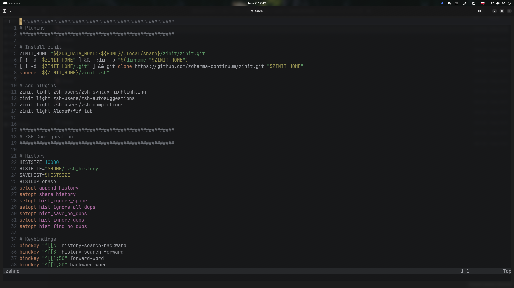

# Islands Dark (Neovim)

A clean, dark Neovim colorscheme based on the IntelliJ IDEA "Islands Dark" theme. Built in Lua with zero dependencies.



## Features

- Exact color matches from the IDEA Islands Dark palette
- Comprehensive **Tree-sitter** support
- Built-in Neovim LSP diagnostic highlights
- First-class support for the `mini.nvim` ecosystem
- Fast and minimal (single core file, no external dependencies)

## Installation

Install using your favorite package manager:

### Native (`vim.pack`)
```bash
vim.pack.add({ "https://github.com/hrbtk/islands-dark.nvim" })
vim.cmd.colorscheme("islands_dark")
```

### [lazy.nvim](https://github.com/folke/lazy.nvim)
```lua
{
  "hrbtk/islands-dark.nvim",
  lazy = false,
  priority = 1000,
  config = function()
    vim.cmd("colorscheme islands_dark")
  end,
}
```

